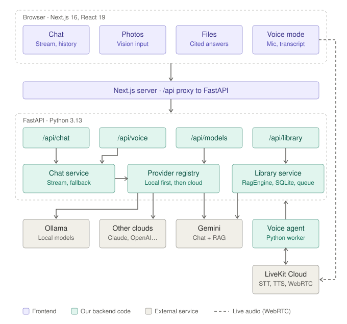

# full-stack-ai-agent

A full-stack AI assistant with four skills: **chat**, **voice**, **photo understanding** and **file Q&A with citations**. It runs **local models through Ollama first** and falls back to **cloud AI** (Anthropic, OpenAI, Gemini, Grok, Meta Llama) when no local model is available or a local model fails.

| Layer | Stack |
|---|---|
| API (`assistant-app/api`) | FastAPI, Python 3.13, uv, ruff, pytest |
| Web (`assistant-app/web`) | Next.js 16, React 19, TypeScript, Tailwind CSS 4, shadcn/ui |
| Voice agent (`assistant-app/agent`) | LiveKit Agents (optional) |
| Local models | Ollama |

## Contents

- [Features](#features)
- [Architecture](#architecture)
- [Quick start](#quick-start)
- [Command reference](#command-reference)
- [Configuration](#configuration)
- [Project structure](#project-structure)
- [Rules and conventions](#rules-and-conventions)
- [Troubleshooting](#troubleshooting)
- [Production checklist](#production-checklist)

## Features

- **Chat**: streaming replies, history, light and dark themes.
- **Model dropdown**: Auto, local Ollama models, or any cloud provider with an API key. If a model fails, the next one answers and the UI says which.
- **Photos**: add by button, paste or drag-and-drop. Resized in the browser, metadata stripped, sent only to vision-capable models.
- **Files and Library**: upload PDF, Word, Excel, PowerPoint, text, CSV, Markdown and code, then get answers with numbered `[n]` citations (Gemini File Search).
- **Voice**: LiveKit-based voice mode that uses the same models and chat history.

## Architecture



## Quick start

**Requirements:** Python 3.13 with [uv](https://docs.astral.sh/uv/), Node.js 20.9+, and optionally [Ollama](https://ollama.com) and Docker.

```bash
# 1. Clone
git clone https://github.com/abrarsaeed001/full-stack-ai-agent.git
cd full-stack-ai-agent/assistant-app

# 2. Local model (optional but recommended)
ollama pull llama3.2

# 3. API  ->  http://localhost:8000/docs
cd api
uv sync
cp .env.example .env        # add cloud API keys here if you have them
uv run fastapi dev app/main.py
```

In a second terminal:

```bash
# 4. Web  ->  http://localhost:3000
cd assistant-app/web
npm install
cp .env.example .env.local
npm run dev
```

On Windows PowerShell use `Copy-Item .env.example .env` instead of `cp`.

### Run with Docker

```bash
cd assistant-app
cp api/.env.example api/.env
docker compose up --build                       # api + web
docker compose --profile voice up --build       # plus the voice agent
docker compose --profile ollama up              # plus Ollama in a container
```

## Command reference

All paths are relative to the repository root.

### API (`assistant-app/api`)

| Task | Command |
|---|---|
| Install dependencies | `uv sync` |
| Run dev server (auto-reload) | `uv run fastapi dev app/main.py` |
| Lint | `uv run ruff check .` |
| Check formatting | `uv run ruff format --check .` |
| Apply formatting | `uv run ruff format .` |
| Run tests | `uv run pytest` |

### Web (`assistant-app/web`)

| Task | Command |
|---|---|
| Install dependencies | `npm install` |
| Run dev server | `npm run dev` |
| Type-check | `npm run typecheck` |
| Production build | `npm run build` |
| Serve production build | `npm run start` |

### Voice agent (`assistant-app/agent`)

| Task | Command |
|---|---|
| Install dependencies | `uv sync` |
| Run (API must be running) | `uv run python voice_agent.py dev` |
| Run tests | `uv run pytest` |

### Docker (`assistant-app`)

| Task | Command |
|---|---|
| Start api + web | `docker compose up --build` |
| Start with voice agent | `docker compose --profile voice up --build` |
| Start with Ollama container | `docker compose --profile ollama up` |
| Stop | `docker compose down` |

### Ollama (local models)

| Task | Command |
|---|---|
| Pull a model | `ollama pull llama3.2` |
| Pull a vision model | `ollama pull gemma3` |
| List installed models | `ollama list` |
| Build the bundled custom models | `ollama create gemma4-local -f Modelfile.gemma4-local` and `ollama create qwen-claude -f Modelfile.qwen-claude` |

### Full quality check (run before every commit)

```bash
cd assistant-app/api && uv run ruff check . && uv run ruff format --check . && uv run pytest
cd ../web && npm run typecheck && npm run build
```

## Configuration

Copy each `.env.example` to its real file. Real `.env` files are git-ignored and must never be committed.

| File | Purpose |
|---|---|
| `assistant-app/api/.env` | Cloud API keys, `CORS_ORIGINS`, `ENVIRONMENT`, `CLOUD_PRIORITY`, `ALLOW_CLOUD_FALLBACK`, library and photo limits, LiveKit credentials |
| `assistant-app/web/.env.local` | `API_URL`, the FastAPI address used by the `/api/*` rewrite |
| `assistant-app/agent/.env` | LiveKit credentials and voice settings (`VOICE_*`) |

A cloud provider is enabled as soon as its API key is set. Details on model selection, photos, voice and Library are in [`assistant-app/README.md`](assistant-app/README.md).

## Project structure

```
full-stack-ai-agent/
├── assistant-app/
│   ├── api/                FastAPI backend (providers, routes, library, voice, tests)
│   ├── web/                Next.js frontend (chat, library, photos, voice components)
│   ├── agent/              LiveKit voice agent
│   ├── docs/               Architecture diagram
│   └── docker-compose.yml
├── .claude/skills/         Claude Code skills used to build and extend the app
├── Modelfile.*             Custom Ollama model definitions
├── src/                    Root Python package scaffold
├── CONTRIBUTING.md         Rules and workflow
└── README.md
```

## Rules and conventions

The short version. See [CONTRIBUTING.md](CONTRIBUTING.md) for the full rules.

1. Never commit secrets. `.env`, `.env.local` and API keys stay local.
2. Run the full quality check above before every commit. It must pass.
3. Keep Python formatted and linted with ruff, and TypeScript passing `npm run typecheck`.
4. Add or update tests for any behaviour change in `api/` or `agent/`.
5. Local models first, cloud second. Do not remove the fallback order without discussion.
6. Add new settings to the matching `.env.example` with a comment.
7. Use short, imperative commit messages (for example `Add citation panel`).

## Troubleshooting

| Problem | Fix |
|---|---|
| No models in the dropdown | Start Ollama and pull a model, or set a cloud API key in `api/.env` |
| Web cannot reach the API | Check `API_URL` in `web/.env.local` and that the API is on port 8000 |
| CORS errors from another origin | Set `CORS_ORIGINS` in `api/.env` |
| Photos ignored by the model | Choose a model marked "Sees images" (`ollama pull gemma3`) |
| No voice button | Set the three `LIVEKIT_*` values in `api/.env` and restart |
| Voice agent never joins | Run `uv run python voice_agent.py dev` in `assistant-app/agent` |
| Files stuck indexing | Check `GEMINI_API_KEY` in `api/.env` and the API log |
| Port already in use | Stop the other process or change the port (`--port` for the API, `-p` for `npm run dev`) |

## Production checklist

- Put both services behind HTTPS and keep response buffering off for `/api/chat` so replies stream.
- Set `ENVIRONMENT=production` (hides `/docs`) and a real `CORS_ORIGINS`.
- Add authentication and rate limiting before exposing the API; cloud and voice calls cost money.
- Chat history lives in each user's browser. Add a database when you add accounts.
